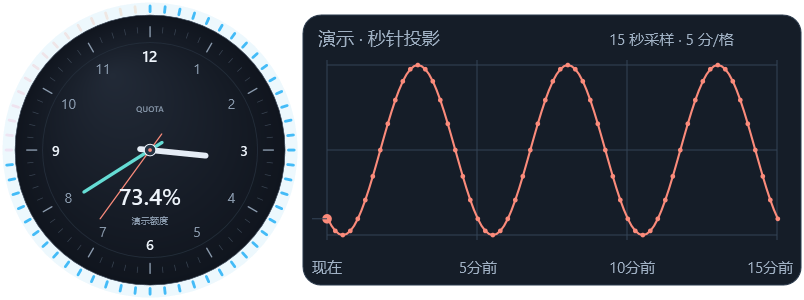
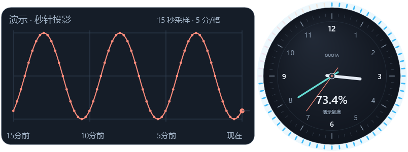

# Quota Clock for Windows

A native Windows tray widget that turns AI quota into a three-hand clock, with a scrolling projection of the fine hand.

**[简体中文](README.zh-CN.md)** · [Performance](docs/PERFORMANCE.md) · [Related projects](docs/RELATED_PROJECTS.md) · [Privacy](docs/PRIVACY.md)



*Illustrative demo data, not an account snapshot. The example consumes 1% every five minutes.*

## What the hands mean

The clock shows quota, not wall time. For remaining percentage R, consumed quota is U = 100 − R:

- The short hand completes one clockwise revolution across 0–100% consumed.
- The long hand completes a revolution per 10% consumed.
- The fine hand completes a revolution per 1% consumed.
- The number and outer ring retain the official remaining percentage.

The fine-hand tip is projected onto a fixed vertical line. History moves away from it, with **five minutes per grid cell** and **one dial radius per cell**. A constant consumption rate of 1% per five minutes makes one cosine cycle per cell. Mirror the history to either side.



## Features

- Draggable desktop dial, tray residency and a compact Windows taskbar component.
- Double-click for details; native WPF settings with light, dark and system themes.
- Official quota reads every 15 seconds by default, using the signed-in local Codex app-server.
- Reusable stdio connection, request serialization, timeout recovery and failure backoff.
- Experimental calibrated fine hand, shown as an amber dashed hand/curve when estimated.
- Bounded trail history: 15-second samples, one-second scrolling, cached paths and no per-frame render loop.
- Explicit demo mode; missing values remain unavailable instead of being shown as full quota.

## Run

Requires Windows 10/11 x64, .NET Framework 4.8, and an installed, signed-in Codex CLI or desktop app. Taskbar embedding has been tested on one Windows 11 setup; Explorer restarts, multiple monitors and mixed DPI need broader testing.

Build from source with the compiler included with .NET Framework:

```powershell
.uild.ps1
.\QuotaClock.exe
```

No .NET SDK or NuGet packages are needed. Close an existing instance before replacing its executable. Preferences are written beside the executable, so use a writable folder.

- Drag the dial or history to move the widget; double-click for quota details.
- Right-click for settings or exit. Closing details/settings keeps the tray app running.
- **Settings → Floating window** controls history visibility and direction.
- **Settings → Data source → Demo mode → Play demo** seeds an explicitly labeled 15-minute sample waveform.

The UI is currently Chinese. Normal history starts empty and accumulates while the app runs; it is not persisted across restarts.

## Precision and interpretation

The installed official interface currently supplies integer percentages. The fine hand can use raw fractional quota when available; otherwise an optional local estimator fits token/model features against observed official quota changes. It pauses when calibration is insufficient or unstable.

**Estimated phase is not official sub-percent precision.** API token prices are not a fixed conversion into subscription quota. The official numeric readout is never replaced by an estimate.

Dots are samples. Connecting them interpolates quota phase for a visual trail; it does not reconstruct unobserved consumption. Missing data, suspend gaps, source changes, backward corrections and large jumps break the curve.

## Performance

In one short Windows 11 / i7-13700H test at 15-second refresh, average process-tree CPU went from about **0.119% to 0.015%**. Average working set stayed close: **115.8 to 113.1 MiB**. These are local measurements, not cross-device guarantees; methods and private-commit costs are documented in [PERFORMANCE.md](docs/PERFORMANCE.md).

The reusable CLI is retired when its private cache exceeds 96 MiB or after 120 reads. Optional working-set reclamation applies only to the app's own idle child and does not free all committed memory or change system settings.

## Test

```powershell
.	est.ps1
```

101 checks cover quota parsing/mapping, calibration, trail sampling/gaps/retention, client reuse/recovery/cache limits, and window lifecycle/layout. Transport tests use a local fake CLI and do not access an account.

## Attribution and prior work

The WPF desktop approach and palette were inspired by [Agent Speed](https://github.com/zoefix/agent-speed). Adapted palette stop values retain the upstream MIT notice in [THIRD_PARTY_NOTICES.txt](THIRD_PARTY_NOTICES.txt).

Other quota monitors and projects named QuotaClock already exist. This implementation focuses on quota-driven three-hand mapping and a fine-hand projection trail; it makes no first-of-its-kind claim. See the [related-project review](docs/RELATED_PROJECTS.md).

Independent project, unaffiliated with OpenAI. [MIT license](LICENSE).
